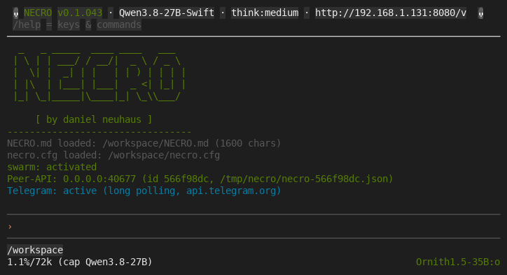
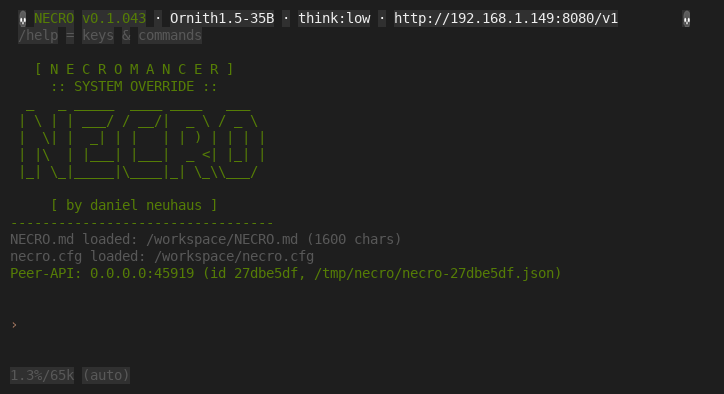

# NECROMANCER (NECRO)

*A self-hosted **coding agent harness** for your terminal — it finds its siblings and works as a team. Zero dependencies, Python 3 stdlib only.*

[](LICENSE)
[](https://www.python.org/)
[](#quickstart)

**NECRO** is a small, self-contained agent harness for the terminal. It is inspired by
[pi-agent](https://github.com/earendil-works/pi) — an amazing product.

One script. No `pip install`, no virtualenv, no 40-package dependency tree. Point it at
any OpenAI-compatible inference server and you have a working agent — and when you run
a second one, they **find each other** and start working in parallel.

---

## The Killer Feature: Peering

> *A local agent with full permissions hands a task to a powerful model in an untrusted
> container — same harness, same tools, zero translation layer.*

This is what makes NECRO more than "another terminal agent."

**The pattern:** You run a trusted NECRO on your machine (or in a Docker container) with
access to your files, your SSH keys, your build tools. It is a capable agent, but its
model has limits — maybe it is a 7B local model, maybe it struggles with complex
architecture decisions.

Now you spin up a **second** NECRO in an *untrusted* container — one that talks to a
frontier model (Gemini, GPT, Claude, whatever) via a hosted API. This container has
**almost the same prerequisites** (same harness, same tools, same working directory via
bind mount) but **not the same permissions** (no SSH keys, no production credentials,
no access to your fleet).

The trusted agent calls `peer` and hands the hard task to the untrusted sibling. The
sibling runs a full agent turn in its own context, on its own model, in its own UI —
and returns the final answer. No API wrappers, no prompt-engineering glue, no
"call this REST endpoint" boilerplate. Just one tool call.

**Why this matters:**

- **Identical prerequisites** — the peer runs the same harness with the same tools, so
  it understands the environment without any translation layer.
- **Least privilege** — the untrusted container never sees your secrets. It gets a
  task description and a shared folder. That is it.
- **Parallel by design** — multiple peers can work on the same project simultaneously,
  each on its own model, in its own terminal.
- **Multi-hop chains** — a peer turn may call another peer (set `peer_max_hops` ≥ 2),
  so you can build parent → child → grandchild pipelines.

### See it in action

| Telegram → Trusted NECRO → Peer (untrusted container) | What the gif shows |
|:---:|:---|
|  | **The full chain:**<br><br>1. **Telegram** — you send a prompt from your phone.<br>2. **Trusted NECRO** — receives the order, decides to delegate the hard part.<br>3. **Peer (untrusted container)** — receives the task via `peer`, runs it on a frontier model (e.g. Gemini), and returns the result.<br><br>The second half is an SSH session into the untrusted container: the peer's UI displays the incoming task in green — proof that the handoff is a real agent turn, not a hidden API call. |

### One-liner: spin up an untrusted peer

```bash
ssh -t [user]@[dockerhost] 'docker compose -f /path/to/docker-compose_untrusted.yml \
  run --rm necro-agent bash -c "NECRO_BASE_URL=https://openrouter.ai/api/v1 \
  NECRO_MODEL=google/gemini-2.5-pro NECRO_API_TOKEN=${OPENROUTER_TOKEN} /app/necro.py"'
```

That is the entire setup. The container is gone after `--rm`. The token is injected
from the host shell — it never touches a config file.

> **Note:** The `docker-compose_untrusted.yml` is not included in this repo (it is
> environment-specific), but the pattern is: one container, one bind mount to the
> shared peer folder, one API token. Functionally verified for container use.

### Scheduling jobs in the untrusted container

The untrusted container can run **supercronic** (a tiny cron for containers). This
lets the unprivileged `necro.py` user pull and plan scheduled jobs — e.g. a nightly
build check, a dependency audit, a code review pass — all executed by the frontier
model, all confined to the container. No root, no host access.

---

## Quickstart (60 seconds)

**Goal:** get a working NECRO agent on a physical machine (laptop, desktop, single
VPS) in under a minute. No Docker, no build step, no package manager.

### What you need

- Python 3.8+ (any distro has it)
- An OpenAI-compatible inference server running somewhere (local llama.cpp, vLLM,
  Ollama, OpenRouter, Groq, …)
- A terminal

### Step-by-step

```bash
# 1. Clone or copy the project
git clone https://github.com/youruser/necro-agent.git ~/necro
cd ~/necro

# 2. Make it executable
chmod +x necro.py

# 3. Run it — point at your model
NECRO_BASE_URL=http://127.0.0.1:8080/v1 \
NECRO_MODEL=Qwen3.8-27B \
NECRO_REMOTE=1 \
./necro.py
```

That is it. You are in a working agent session. Type a prompt, press Enter.

### Project layout

```
~/necro/
├── data/              # session DB (SQLite), created on first run
├── modules/
│   ├── core/          # agent loop, tool execution
│   ├── io/            # inference client, peer discovery
│   └── ui/            # terminal rendering
├── necro.py           # entry point (the only file you run)
└── necro.cfg          # optional config (JSON)
```

### Configuration

`necro.cfg` is **optional**. Environment variables always take precedence. If you do
not provide either, NECRO will prompt you at startup.

Minimal `necro.cfg`:

```json
{
  "base_url": "http://127.0.0.1:8080/v1",
  "model": "Qwen3.8-27B",
  "remote": true
}
```

### Two sessions, two models (peering in 10 seconds)

Open a second terminal in the **same folder**:

```bash
# Terminal 1
NECRO_BASE_URL=http://127.0.0.1:8080/v1 NECRO_MODEL=Qwen3.8-27B NECRO_REMOTE=1 ./necro.py

# Terminal 2 — same project, different model
NECRO_BASE_URL=http://127.0.0.1:8080/v1 NECRO_MODEL=Ornith1.5-35B NECRO_REMOTE=1 ./necro.py
```

Both sessions discover each other automatically (shared folder = shared peer
registry). Now session 1 can `peer` a task to session 2 and vice versa. No config,
no endpoints, no auth setup.

**Same host, multiple sessions:** you do not need different models to benefit from
peering. If your model is strong and performant enough, you can run several sessions
against the **same** inference server and peer between them. Useful when you want
parallel workstreams on the same codebase (e.g. one session refactors module A while
another writes tests for module B), or when you want a "fresh context" sibling that
has not seen the 200 messages of your current session. The model does the heavy
lifting; the harness keeps the contexts isolated.

> **Multiple sessions on one client:** copy NECRO into its own folder per planned
> session. Each copy then has its own session DB and does not mix history with the
> others.

### Peering in the terminal

| Giving orders to a peer | The peer responds (delegated / consulted) |
|:---:|:---:|
|  |  |

---

## Telegram (drive it from your phone)

NECRO includes a built-in Telegram bot. Send prompts, `/stop`, `/new`, `/compact`,
`/model`, `/status`, `/help` — from anywhere.

Setup: add your bot token and chat-ID whitelist to `necro.cfg`:

```json
{
  "telegram_token": "123456:ABC-DEF...",
  "telegram_chats": ["your_chat_id"]
}
```

The chat-ID whitelist keeps strangers from spending your tokens. That is the entire
security model — one allow-list, no auth server.

Combined with peering, this gives you the full chain shown in the gif above:
**phone → Telegram → trusted NECRO → peer (untrusted container) → frontier model**.

---

## Swarm (delegate / consult)

A swarm is a list of other models (each on its own inference server) that the main
model can use as **sub-agents**:

- `delegate` — hands a self-contained task to a swarm agent. It runs its own tool loop
  (bash, read_file, ...) in the same working directory and returns the result.
- `consult` — bot-to-bot consultation: the swarm agent may ask up to 3 follow-up
  questions, which you answer (it sees only your answers, not your full context).
  Good for second opinions and reviews.

Both tools are only registered when a `swarm` is configured in `necro.cfg`.

**Ping-pong protection (quick & dirty):** sub-agents do not receive the
`delegate`/`consult`/`peer` tools, so a sibling cannot hand tasks back to the master
while it is busy. Note: this is a tool-level guard, not a hard guarantee — the model
can still be prompted to do such things.

**Nested delegate (opt-in):** `subagent_delegate` (default `false`) re-adds `delegate`
to sub-agents for parallel decomposition. Nesting is explicitly capped by
`subagent_max_depth` (default 1 = direct delegate only, no nesting).

---

## Features

- **Tiny harness** — one main script plus a few modules, Python 3 standard library only, no dependencies to install
- **Automatic context size** — NECRO queries the inference server for the model's current context window at startup; no manual `ctx_window` needed
- **Telegram bot** — drive a session from your phone; chat-ID whitelist keeps strangers out
- **Peer & Swarm** — NECRO instances talk to each other: a fleet of containers can work on the same project in parallel
- **Sub-agents** — `delegate` (hand a task to another model) and `consult` (bot-to-bot dialogue with follow-up questions)
- **Safety breaks for unattended runs** — per-turn wall-clock timeout and per-session turn cap
- **SQLite session DB** with `recall` — keyword search over past sessions (last 7 days)

---

## Documentation

Deeper dives live in `_docs/`:

| Doc | Content |
|-----|---------|
| [`startparams.md`](_docs/startparams.md) | All configuration sources: CLI flags, env vars, `necro.cfg` keys |
| [`providers.md`](_docs/providers.md) | Provider profiles and the model probe (`/model`) |
| [`agent-lifecycle.md`](_docs/agent-lifecycle.md) | The agent loop: turns, steps, tool execution, sub-agents |
| [`peer-mechanism.md`](_docs/peer-mechanism.md) | How sibling instances discover each other and delegate turns |
| [`swarm.md`](_docs/swarm.md) | Swarm sub-agents: delegate/consult, name resolution, availability checks |
| [`telegram.md`](_docs/telegram.md) | Telegram bridge: long polling, whitelist, commands |
| [`tools.md`](_docs/tools.md) | Core tools: bash, grep, read/write, output caps |
| [`testing.md`](_docs/testing.md) | Test suite: layout, conventions, how to run |
| [`data-model.md`](_docs/data-model.md) | Session DB (SQLite) schema and pruning |
| [`tui-rendering.md`](_docs/tui-rendering.md) | Terminal UI: rendering, colors, keys |
| [`security.md`](_docs/security.md) | Guardrails for unattended operation |

---

## Safety warning

Peer/swarm is a young idea — it works, but it was not built with enormous care for
safety (no auth on the peer API, quick & dirty ping-pong guard). Do not run it
unattended on a machine where that matters yet. The untrusted-container pattern
mitigates this: the powerful model never gets your credentials.

---

## License

| License | NECROMANCER (NECRO) |
| :--- | :---: |
| [GPL-3.0](LICENSE) (copyleft) — derivatives must stay open source.<br><br>Copyright (C) 2026 Daniel Neuhaus |  |
